# Cobus van Staden

Systems architect and founder of [Rooted to Grow](https://rootedtogrow.co.za). I build AI-assisted workflows, dashboards and operational systems for South African organisations.

<!-- profile-cards:start -->
<table align="center">
  <tr>
    <td width="55%" valign="top"></td>
    <td width="45%" valign="top"></td>
  </tr>
</table>

  

<!-- profile-cards:end -->

<a href="https://rootedtogrow.co.za">rootedtogrow.co.za</a> · <a href="mailto:cobus@rootedtogrow.co.za">cobus@rootedtogrow.co.za</a>

